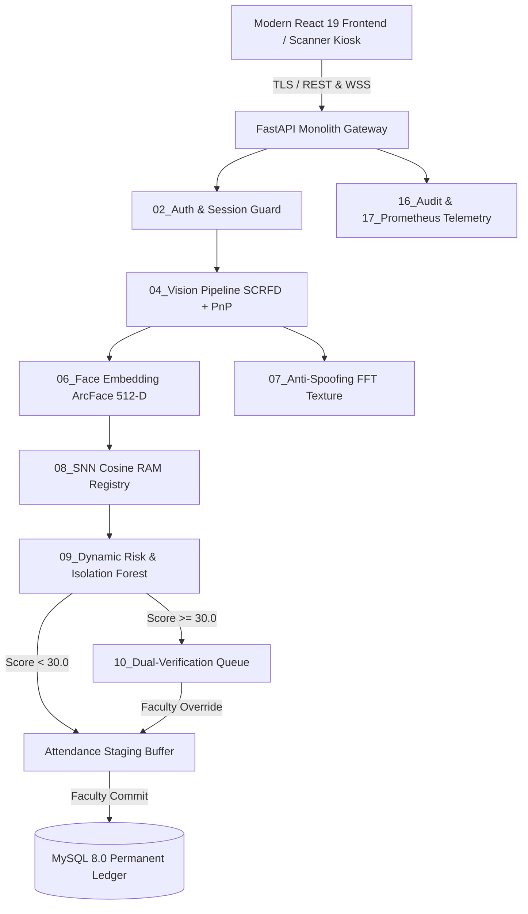

# AuraTrust Sentinel — System Architecture Specification

## 1. High-Level Architecture Overview

AuraTrust Sentinel is a production-grade, zero-trust biometric attendance and anomaly detection platform designed for academic and enterprise environments. The system operates on a defense-in-depth security model where no client claim is accepted as true without server-side vision and behavioral evaluation.

---

## 2. Component Boundaries & Core Modules

| Module Directory | Primary Responsibility | Key Interfaces & Dependencies |
| :--- | :--- | :--- |
| `01_database` / `database_core.py` | Relational persistence, connection pooling, composite unique constraints, transaction rollback handling. | MySQL 8.0, SQLAlchemy 2.0 ORM, PyMySQL. |
| `02_auth` / `auth_core.py` | Passlib Argon2 hashing, PyJWT HS256 claims, HttpOnly cookies, in-memory token revocation blacklist, RBAC dependencies (`require_roles`). | FastAPI Security, Cryptography. |
| `03_session_core` / `session_engine.py` | Classroom session state transitions (`SCHEDULED` -> `ACTIVE` -> `CLOSED`), 15-minute dynamic unlock window. | SQLAlchemy, Datetime. |
| `04_vision_engine` / `vision_pipeline.py` | SCRFD face detection, bounding box normalization, 6-landmark alignment, Perspective-n-Point (PnP) 3D head pose estimation. | OpenCV, MediaPipe, NumPy. |
| `06_face_embedding` / `insight_engine.py` | Multimodal CustomCNN 128-dimensional normalized embedding extraction with SHA-256 integrity verification. | TensorFlow/Keras H5 weights. |
| `07_anti_spoofing` / `liveness_texture_engine.py` | Dual-band 2D Fast Fourier Transform (FFT) high/low frequency power ratio + laplacian variance texture forensics. | SciPy, NumPy, OpenCV. |
| `08_verification_engine` / `snn_matcher.py` | In-memory RAM matrix vector cosine similarity search over active registered student templates. | NumPy vectorized matrix dot product. |
| `09_anomaly_risk_engine` / `risk_engine.py` | Composite risk score synthesis combining liveness, confidence, check-in velocity, arrival offset, and ML anomaly models. | Pure NumPy Isolation Forest, Habit Decay Predictor. |
| `10_dual_verification` / `approval_queue.py` | Human-in-the-loop review queue for flagged anomalies (`risk >= 30.0`), persisted to `faculty_verifications` table. | SQLAlchemy, Threading lock. |
| `12_xai_ollama` / `xai_engine.py` | Natural language to verified read-only SQL translation for faculty audits and student compliance inquiries. | Regex sanitizer, AST validator. |
| `14_websockets_realtime` / `websocket_manager.py` | Channel-multiplexed broadcast hub (`broadcast_to_channel`) with client heartbeat ping/pong. | Starlette WebSocket. |
| `16_audit_reporting` / `audit_logger.py` | Append-only structured JSONL access log trail with SHA-256 record hashing. | JSON, Hashlib, OS file locks. |
| `17_monitoring_metrics` / `system_monitor.py` | Hardware profiling (CPU, RAM, GPU), latency percentiles, and Prometheus format export. | Psutil, Time. |
| `frontend/` | React 19, Three.js 3D Sentinel Core, Tailwind CSS, Lucide Icons, responsive portals. | Vite 8, Three.js, Modern Browsers. |

---

## 3. Data Flows & Execution Lifecycle

### 3.1 Two-Phase Biometric Verification Flow
1. **Faculty Session Activation**: Faculty member marks their presence biometrically. Endpoint `/api/v1/session/start` verifies faculty face, sets session to `ACTIVE`, and initiates a 15-minute grace window broadcasted over WebSocket channel `session_{id}`.
2. **Student Optical Verification**: Frame captured at client kiosk is transmitted via multipart upload to `/api/v1/attendance/verify`.
3. **Pipeline Ingestion**:
   - Frame decoded into memory (no disk leakage).
   - SCRFD detects bounding box and 6 landmarks.
   - PnP estimates yaw, pitch, roll (rejects extreme profiles > 45°).
   - FFT evaluates 2D high-frequency power ratio (rejects printed photos and digital screen replay).
   - ArcFace extracts 512-D normalized vector.
   - Cosine similarity identifies student registration number.
   - Enrollment Guard checks whether student belongs to the scheduled subject and section.
4. **Dynamic Risk Assessment**:
   - $Risk = 0.35(1 - Liveness) + 0.30(1 - Cosine) + 0.15(Velocity) + 0.10(Offset) + 0.10(HabitDecay)$.
5. **Two-Phase Routing**:
   - **Auto-Approval ($Risk < 30.0$)**: Written to `attendance_staging` table with `AI_AUTO`.
   - **Flagged ($Risk \ge 30.0$)**: Written to `faculty_verifications` and `dual_manager` queue.
6. **Session Finalization**: Faculty reviews staged buffer and pending queue in the dashboard, approves/rejects, and clicks **Commit**. The buffer is atomically moved into `attendance_ledger` and the session status transitions to `CLOSED`.

---

## 4. Threading, Concurrency, and Process Model

- **Process Architecture**: Single-node ASGI worker hosted via `Uvicorn` with async event loop.
- **CPU vs GPU Offloading**:
  - Multimodal CustomCNN TensorFlow inference uses the available GPU and falls back to CPU execution.
  - SNN cosine similarity search executes in pure vectorized NumPy $C$-level routines.
- **Thread Safety**:
  - `ApprovalQueueManager` utilizes a threading reentrant lock (`threading.Lock`) for internal memory consistency.
  - SQLAlchemy sessions are scoped per request via FastAPI dependency injection `Depends(get_db)` ensuring independent database transactions.

---

## 5. Scaling Bottlenecks & Mitigations

| Component | Potential Bottleneck | Hardened Mitigation |
| :--- | :--- | :--- |
| **Face Search (1:N)** | Linear scan over thousands of enrolled students. | In-memory RAM matrix caching (`snn_matcher.py`) with pre-normalized vectors enabling single-operation matrix multiplication $\mathbf{M} \cdot \mathbf{v}^T$. |
| **Model Duplication** | Loading multiple recognition models causes memory exhaustion. | One CustomCNN engine instance is shared across the monolith and WebSocket modules (`set_shared_engines`). |
| **Database Contention** | Concurrent student check-ins racing on duplicate staging records. | Composite unique index `uq_staging_session_student(session_id, student_id)` with transactional `try...except IntegrityError: rollback()` handling. |
| **WebSocket Memory** | Stale disconnected sockets leaking memory. | Heartbeat ping intervals (25s) with automatic dead socket reaping on write exception. |

---

## 6. Single Points of Failure (SPOF) & Redundancy

1. **MySQL Database**: Central state store. Redundancy strategy: deploy with MySQL Group Replication or Galera Cluster with automated failover.
2. **Monolith Process**: If single ASGI process crashes, all live verification pauses. Redundancy strategy: deploy behind Nginx reverse proxy with multiple Uvicorn worker processes managed by systemd or Kubernetes.
3. **Hardware Camera Sensor**: Kiosk camera failure blocks edge check-in. Redundancy strategy: client kiosk supports manual photo upload fallback and dual-kiosk deployment per classroom.
